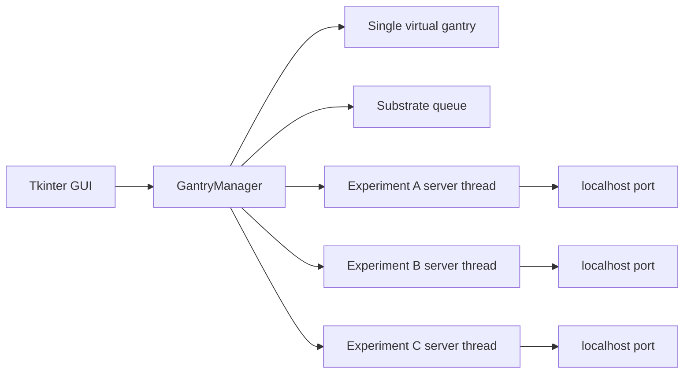

# Gantry Lab Simulator

A deterministic gantry scheduling simulation for a small lab workflow, built to model one gantry moving samples between experiment stations while enforcing realistic constraints:

- only one gantry can move at a time
- a station cannot be re-used while it is still busy
- a substrate cannot be picked up again immediately after finishing a step if the gantry is still in motion
- each experiment is backed by its own live TCP status server
- every sample carries route metadata and workflow state in a dedicated `Substrate` model

This is not just a visual toy. The simulation is grounded in a real event scheduler and actual localhost experiment endpoints.

## Screenshots

### Configuration view

The initial view shows the experiment floor, separate shelf-access station, shelf inventory, route editor, experiment settings, and controls.


### Active simulation

The active view shows the gantry moving through the floor, live client status, queue progress, experiment timers, and per-substrate route markers.


## What this project simulates

The system models a lab floor with:

- a single gantry arm
- three experiment stations: A, B, and C
- a shelf for queued and completed samples
- per-sample route ordering and progress tracking
- live status from each experiment over TCP

The scheduler advances by event time instead of real wall-clock sleep, which keeps the behavior deterministic and easy to reason about while still reflecting the lab's real timing constraints.

## Core behavior

### Single gantry occupancy
The gantry can only do one movement at a time. It does not overlap deliveries or pickups, and it cannot immediately process a sample that is still leaving or arriving at a busy station.

### Fixed travel time
Movement is a constant, fixed duration so the gantry's travel timing is realistic and consistent across all operations.

### Substrate tracking
Each sample is represented by a `Substrate` object with:

- unique sample ID
- ordered route through experiments
- current progress index
- current location
- completion state
- metadata dictionary for sample-specific information

This keeps route logic and sample identity separated from the transport state.

### Separate live experiment endpoints
Each experiment client runs its own thread and exposes JSON status over a real TCP socket. The GUI and scheduler both read from the same live endpoint model rather than faking values in memory.

## Project structure

- `gantry.py` — core scheduler, gantry logic, experiment clients, and TCP server implementation
- `substrates.py` — dedicated `Substrate` model and workflow state
- `gantry_gui.py` — Tkinter visualizer and simulation controls
- `test_unittests.py` — deterministic behavior and validation tests
- `timer.py` and `timerClient.py` — legacy timer prototype retained for reference

## Architecture



The GUI is an observer and control surface. The manager owns scheduling and transport state, while each experiment server owns the status endpoint for its client.

## Scheduling model

1. A substrate starts on the shelf.
2. The gantry travels to the floor-level shelf-access station.
3. It picks up one substrate and delivers it to the next experiment in that substrate's route.
4. The experiment client processes the substrate for its configured duration.
5. The manager polls the client's TCP endpoint. A finished substrate joins the pickup queue.
6. The gantry returns the substrate to its next experiment or to the shelf when its route is complete.
7. If a destination is occupied, the substrate waits or is staged on the shelf; it is never placed into a busy client.
8. Every gantry leg uses the same fixed movement time, independent of visual distance.

## Run the simulator

From the project folder:

```bash
python3 gantry_gui.py
```

This opens the GUI with:

- experiment floor view
- gantry position and movement
- shelf inventory area
- queue and status panels
- editable sample routes and experiment settings

## Run the tests

```bash
python3 -m unittest discover -v
```

This project is validated against a small deterministic suite covering:

- substrate queue insertion while work is running
- TCP experiment server status handling
- route parsing and validation
- three random experiment runs preserving order and occupancy rules

## GUI controls

The route editor accepts one substrate route per line using `A`, `B`, and `C`:

```text
A,B,C
C,A
B,C
```

The count must match the number of non-empty route lines. The simulator supports up to 30 substrates. The **Queue** control adds a new substrate to the live run without resetting active work.

Experiment duration and floor-position fields are editable before applying a setup. The shelf inventory has its own scrollbar and can be scrolled with the scrollbar, mouse wheel, or trackpad.

Substrate cards use colored route markers:

- green means the experiment step is complete
- red means the step is still pending

Station status rows show the sample ID, elapsed time, remaining time, duration, and the TCP port being polled.

## TCP experiment servers

The manager starts three independent daemon server threads, one for each experiment. Each binds a dynamic localhost port and responds to:

```text
STATUS <simulation_time>
```

For example:

```bash
printf 'STATUS 11.8\n' | nc 127.0.0.1 49461
```

The JSON response includes the experiment name, state, sample ID, elapsed time, remaining time, port, and server thread name. Ports are intentionally dynamic and are shown live in the GUI.

## Example workflow

The simulator starts with a default queue of samples and routes, then lets you:

1. change the route list
2. set per-experiment durations and positions
3. enqueue additional samples dynamically
4. start the run and watch the gantry move through the floor
5. inspect queue, status, and completed sample flow in real time

## Why this design works well

The simulation balances realism and readability:

- transport decisions are deterministic and inspectable
- each sample owns its own route and completion metadata
- multiple clients operate independently in their own threads
- the GUI clearly separates shelf storage from active experiment stations
- the logic remains easy to extend for more stations, larger sample queues, or added lab constraints

## Verification

The project was verified with actual live socket checks, and the unit suite passes.

The current validation command and result:

```bash
python3 -m unittest discover -v
```

This passed successfully with the project’s test suite covering the key gantry rules.

## Troubleshooting

### The terminal stays busy

That is expected while the Tkinter window is open. `python3 gantry_gui.py` is a foreground desktop application. Close the window to stop the GUI and its server threads cleanly.

### TCP ports change between runs

That is expected. Each experiment server binds an available ephemeral localhost port to avoid collisions with other processes.

### Tkinter is unavailable

Check the selected Python installation with:

```bash
python3 -c "import tkinter; print('Tkinter available')"
```

Use a desktop Python distribution that includes Tk support if this import fails.

### Capture a fresh macOS screenshot

The checked-in screenshots were captured from the running app. To capture another app-only image, launch the GUI and use macOS Screenshot or:

```bash
screencapture -x -l <window-id> assets/gantry-lab-current.png
```

The window ID can be obtained with a macOS window-inspection tool.

## Notes

This repository is ideal for exploring how a single constrained automation resource behaves under queue pressure, blocked pickups, and multi-step sample workflows without introducing unrealistic overlaps or invalid state transitions.
