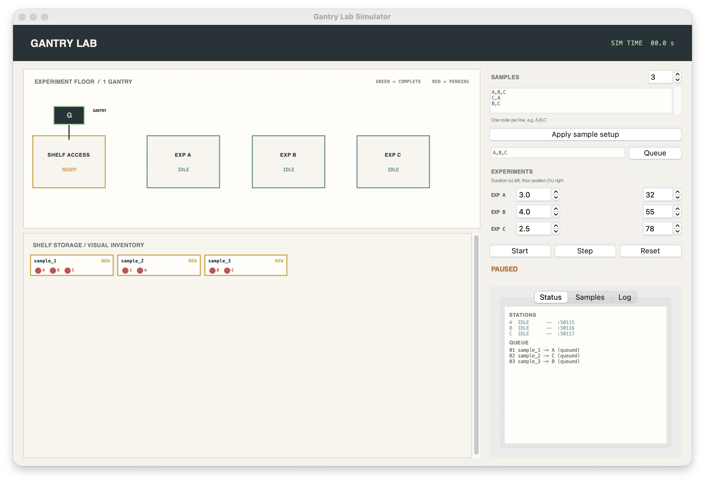
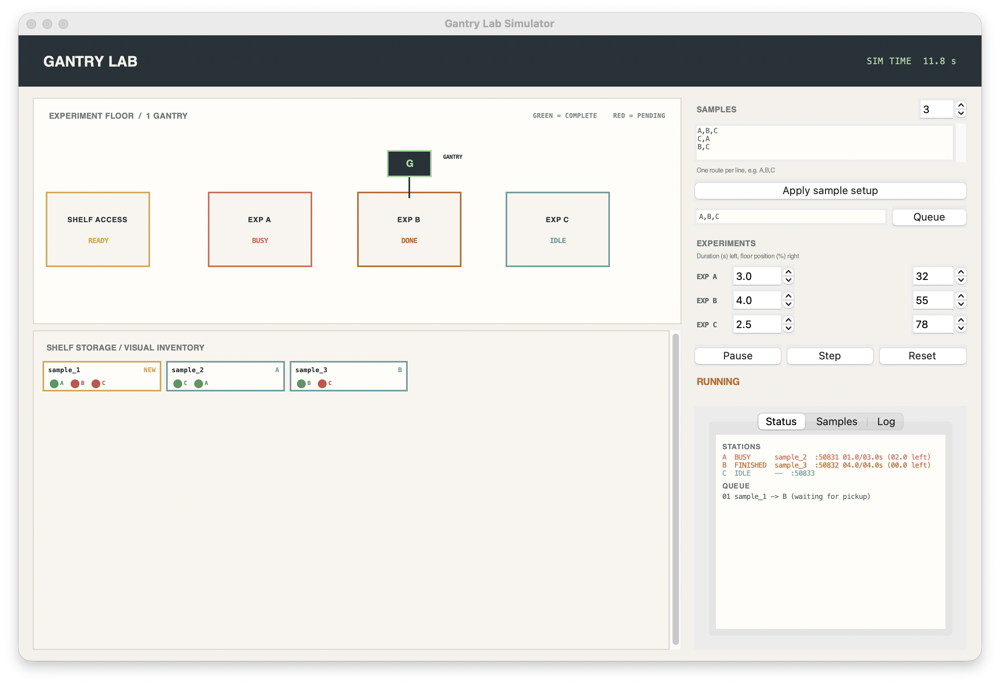
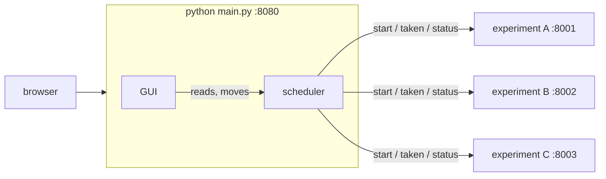

# Gantry Manager

Schedules one gantry moving samples between lab experiment stations. It drives
real instruments over HTTP, and ships fake nodes (`sim/`) so the whole setup
runs on one computer with no hardware. It enforces these constraints:

- only one gantry can move at a time
- a station cannot be re-used while it is still busy
- a substrate cannot be picked up again immediately after finishing a step if the gantry is still in motion
- each experiment is backed by its own live HTTP status server (labnode)
- every sample carries route metadata and workflow state in a dedicated `Substrate` model

Related repos (clone them next to this one):

- [labnode](https://github.com/henrybon806/labnode): the small HTTP API every experiment node speaks
- [lab-devices](https://github.com/henrybon806/lab-devices): the real hardware nodes (instruments, and later the gantry)

## Configuration view

The initial view shows the experiment floor, separate shelf-access station, shelf inventory, route editor, experiment settings, and controls.



### Active simulation

The active view shows the gantry moving through the floor, live client status, queue progress, experiment timers, and per-substrate route markers.



## What this project simulates

The system models a lab floor with:

- a single gantry arm
- three experiment stations: A, B, and C
- a shelf for queued and completed samples
- per-sample route ordering and progress tracking
- live status from each experiment over HTTP

The scheduler advances by event time instead of real wall-clock sleep, which keeps the behavior deterministic and easy to reason about while still reflecting the lab's real timing constraints.

## Core behavior

### Single gantry occupancy
The gantry can only do one movement at a time. It does not overlap deliveries or pickups, and it cannot immediately process a sample that is still leaving or arriving at a busy station.

### Fixed travel time
Movement is a constant, fixed duration so the gantry's travel timing is realistic and consistent across all operations.

### Substrate tracking
Each sample is represented by a `Substrate` object with:

- unique sample ID
- ordered route through experiments
- current progress index
- current location
- completion state
- metadata dictionary for sample-specific information

This keeps route logic and sample identity separated from the transport state.

### Separate live experiment endpoints
Each experiment is its own process exposing labnode JSON status over HTTP. The GUI and scheduler both read from those live endpoints rather than faking values in memory.

## Project structure

```text
gantry/            the gantry
  scheduler.py       scheduling core: GantryManager, in-memory and remote experiment clients
  substrates.py      Substrate model and workflow state
  server.py          scheduler thread + its API (/pos, /state); python -m gantry runs it without the GUI
web/               the GUI, a local website (python -m web runs it alone)
  server.py          serves the page, polls nodes for it, forwards moves, saves presets
  static/index.html  the page
helpers/           shared code
  polling.py         reading labnode nodes; NOT STARTED / UNABLE TO READ
  calibration.py     HOME/REF calibration between gantry and bed coordinates
  presets.py         loading, checking and saving presets.json
sim/               fake hardware for running without a lab, one terminal each
  experiment_a.py …  fake experiment nodes with a fixed name, port and duration
  node.py            generic fake node (letter, port, duration as arguments)
  fake_gantry.py     fake gantry node (:8100): receives move, pick and place and prints them
tests/             unit and end-to-end tests
legacy/            the old Tkinter GUI and the timer prototype, kept for reference
data/              your settings
  presets.json       written by the GUI's Save presets, read by the gantry and the GUI
  gantry_layout.json older settings file, imported once if presets.json is missing
assets/            screenshots
main.py            the normal way to run: scheduler + gantry API + GUI in one process
requirements.txt   labnode, pinned to a release tag
```

## Architecture



`python main.py` runs the GUI and the scheduler in one process, on one port.
The GUI reads everything (node statuses, the gantry, the samples) straight
from the scheduler, and only the scheduler talks to the nodes. Each experiment
node is its own
process, usually on its instrument's computer. The GUI is an observer that can
only move the gantry; the scheduler owns scheduling and transport state; each
node owns its experiment.

## Scheduling model

1. A substrate starts on the shelf.
2. The gantry travels to the floor-level shelf-access station.
3. It picks up one substrate and delivers it to the next experiment in that substrate's route.
4. The experiment client processes the substrate for its configured duration.
5. The manager polls the client's HTTP /status endpoint. A finished substrate joins the pickup queue.
6. The gantry returns the substrate to its next experiment or to the shelf when its route is complete.
7. If a destination is occupied, the substrate waits or is staged on the shelf; it is never placed into a busy client.
8. Every gantry leg uses the same fixed movement time, independent of visual distance.

## Run it

Every piece is its own process. Install once:

```bash
python3 -m venv .venv
.venv/bin/pip install -r requirements.txt
```

labnode lives in its own repo, [henrybon806/labnode](https://github.com/henrybon806/labnode),
pinned to a tag in `requirements.txt`. To work on it alongside the gantry, clone
it next to this repo and install from there with `.venv/bin/pip install "../labnode[test]"`.
Use a regular install rather than `pip install -e`: on this Mac the `.venv`
folder carries the macOS "hidden" flag, and Python 3.13 skips the hidden
`.pth` file an editable install relies on. Reinstall after changing labnode.

Then open one terminal per process, in any order:

```bash
.venv/bin/python sim/experiment_a.py     # terminal 1
.venv/bin/python sim/experiment_b.py     # terminal 2
.venv/bin/python sim/experiment_c.py     # terminal 3
.venv/bin/python sim/fake_gantry.py      # terminal 4 (optional): the gantry node
.venv/bin/python main.py                 # terminal 5: scheduler + GUI, then open http://127.0.0.1:8080
```

The scheduler times every gantry leg itself (`move_time`) and, as it goes,
sends the gantry node at `gantry_address` (default `127.0.0.1:8100`) a `move`
to each station, then `pick` or `place` there. It assumes each command worked
and carries on; commands go out in order on their own thread, each waiting for
the gantry to finish the last. If the gantry rejects one or is not running, the
GUI shows it under the gantry readout (e.g. *move not available: gantry NOT
STARTED*) and the terminal prints it once. Clear the gantry address (or pass
`--gantry ""`) to only simulate the gantry.

The gantry position the GUI draws is always the one the gantry node reports
(the scheduler listens to its `/status`), never an estimate. If the node cannot
be read, no dot is drawn and the readout says why. Only with no gantry address
is the position simulated, and the readout then says *SIMULATED*.

`main.py --no-gui` (or `python -m gantry`) runs the scheduler and its API
without the GUI, on `--port` (default 8200); `python -m web` runs only the GUI, to watch a gantry running
elsewhere. `--gui-port` moves the GUI off 8080.

`main.py` takes its settings from `data/presets.json` (see **Presets**
below). Any flag overrides its preset, e.g.:

```bash
.venv/bin/python main.py --gantry 127.0.0.1:8100 --home 0,0 --shelf 300,500 --slots 10 \
    --node A=8001@1050,750 --node B=8002@1800,250 --node C=8003@2550,650 \
    --route A,B,C --route C,A --route B,C --move-time 1
```

Each experiment file in `sim/` has a fixed name, port and duration (A :8001 3 s,
B :8002 4 s, C :8003 2.5 s). For a different port or duration without editing
a file, use the generic node instead:

```bash
.venv/bin/python sim/node.py A --port 8001 --duration 3
```

Real instruments live in [lab-devices](https://github.com/henrybon806/lab-devices);
start a new one from its `templates/experiment/`. To point the gantry at real nodes, put their
addresses in `data/presets.json` (or pass `--node`).

The real gantry is a `Gantry` node in lab-devices (`templates/gantry/`); point
`gantry_address` at it instead of the fake one.

`main.py` with no arguments uses exactly those nodes and routes. It
drives the nodes over HTTP (`POST /start`, `POST /taken`) on wall-clock time
and serves its API under `/scheduler` on the GUI's port (on `--port`, default
8200, with `--no-gui`).

`@x,y` is where each station sits on the bed, in mm from the bottom-left corner. The gantry has its own `--home`
spot, separate from the shelf: it starts there and travels to the shelf like
any other location. Ask it where it is at any time:

```bash
curl http://127.0.0.1:8080/scheduler/pos
# {"x": 21.2, "y": 36.7, "z": 0.0, "moving": true, "at": null}
```

Move it while it is stopped (this takes the normal move time; it answers 409
while the gantry is moving, and needs `Authorization: Bearer $LABNODE_TOKEN`
when a token is set):

```bash
curl -X POST http://127.0.0.1:8080/scheduler/pos -H 'content-type: application/json' -d '{"x": 40, "y": 20}'
```

The scheduler waits for the move, then carries on from that spot. In the GUI,
the **MOVE GANTRY** box (or a double-click on the bed) sends the same request.

`at` names the location when the gantry is stopped (`home`, `shelf`,
`experiment_a`, ...). `GET /position` returns the same thing, so the
GUI's *Lab (HTTP)* mode can point at the gantry. A node that is not running counts as busy,
so the gantry never delivers to it; samples wait on the shelf until it is up.

The GUI only sends one command, the gantry move; everything else is read. Type
the gantry address under **GANTRY SOURCE** and each node's address in the
**EXPERIMENTS** list (defaults match the commands above). Anything it cannot
read is labelled:

- **NOT STARTED**: nothing answers at that address
- **UNABLE TO READ**: something answered, but not with a valid status or state

The reason (for example `Connection refused`) is shown under the gantry source.

## Run the tests

```bash
.venv/bin/python -m unittest discover -v
```

This project is validated against a small deterministic suite covering:

- substrate queue insertion while work is running
- HTTP experiment status handling and the visualization poller
- route parsing and validation
- three random experiment runs preserving order and occupancy rules

## Experiment nodes (labnode)

Every experiment, real or simulated, is a [labnode](https://github.com/henrybon806/labnode)
HTTP node. A real instrument computer runs a small `Experiment` subclass that
implements `run()` (and optionally `stop()`), which gives it:

```text
GET  /status     idle | busy | stopping | done | stopped | error, plus sample and timing
POST /start      {"sample_id": ..., "params": {...}}
POST /stop       emergency stop
POST /taken      sample removed, back to idle
GET  /position   gantry node only
```

`sim/node.py` is a simulated node of this kind; nothing starts it for you.

```bash
curl http://127.0.0.1:8001/status
curl http://127.0.0.1:8080/scheduler/state
```

## GUI

`python main.py` serves the GUI as a local website on http://127.0.0.1:8080
(`--port` to change it). It listens on loopback only, since the page can move
the gantry. The server polls the nodes and the gantry for the page (browsers
cannot read the nodes directly) and forwards moves to the gantry.

The page shows the bed full width at its real shape (3000 × 1000 mm by
default), with the live gantry and each experiment's state, and the gantry's
X, Y and Z right under it. Settings are in cards below. It has no run
controls: sample routes come from `presets.json` (`"routes"`) or `--route`
for now, and durations from each node. Restart `main.py` to run a new batch.

- **Gantry**: the gantry node's address (empty to only simulate the gantry),
  the last command's result, its home spot and the move time.
- **Move gantry**: type x, y in mm and press *Move gantry*, or double-click an
  empty spot on the bed. The reply shows, e.g. *Refused: gantry is busy moving*.
- **Bed & shelf**: bed size in mm and the number of shelf slots.
- **Experiments**: set each node address (`http://host:port`, `host:port` or a
  port), drag boxes to place them, and add or remove experiments.
- Edits apply straight away (every open tab sees them) but are only written
  to disk when you press **Save presets**. *Reload* throws away unsaved edits.

The server's API, if you want to script it:

```text
GET  /api/presets    PUT /api/presets    POST /api/presets/save    POST /api/presets/reload
GET  /api/snapshot   POST /api/move {"x", "y"}   GET /api/gantry/stream (main.py only)
```

The older Tkinter window (`python -m legacy.gantry_gui`) still works but keeps its
own `data/gantry_layout.json`.

## Presets

`data/presets.json` holds everything you would otherwise re-enter each run. Edit
it in the web GUI and press **Save presets**; `main.py` (and
`python -m gantry`, `python -m web`) read it at startup (`--presets` to use another file).

```json
{
  "bed": [3000.0, 1000.0],
  "gantry_address": "127.0.0.1:8100",
  "scheduler_address": "127.0.0.1:8200",
  "gantry_home": [0.0, 0.0],
  "move_time": 1.0,
  "shelf_slots": 10,
  "calibration": {"home_raw": null, "home_bed": [0.0, 0.0], "scale": [1.0, 1.0]},
  "stations": [
    {"name": "shelf", "address": "", "x": 300.0, "y": 500.0},
    {"name": "experiment_a", "address": "127.0.0.1:8001", "x": 1050.0, "y": 750.0}
  ],
  "routes": ["A,B,C", "C,A", "B,C"]
}
```

- The bed is 3000 × 1000 mm by default. Positions are bed coordinates in mm,
  with (0, 0) at the bottom-left corner, as the GUI shows them. The scheduler
  converts them to gantry coordinates through the saved calibration.
- `gantry_address` is the gantry node the scheduler sends move, pick and place
  to; empty means the gantry is only simulated.
- `scheduler_address` is only for `python -m web` on its own: where it finds a
  scheduler started with `--no-gui`.
- Stations without a node address are drawn but not used by the gantry.
- Route entries are letters (`A` → `experiment_a`) or station names.
- The number of routes cannot exceed `shelf_slots` (at most 30).
- If there is no `data/presets.json` yet, the first run starts from an existing
  `data/gantry_layout.json`, so nothing you set up before is lost.
- Experiment durations are not presets: each experiment decides its own run
  time (see `sim/`).

## Troubleshooting

### The terminal stays busy

That is expected: `python main.py` and each experiment are servers that run until you press Ctrl+C in their terminal. Closing the browser tab does not stop anything.

### The page says GUI SERVER DOWN

`python main.py` is not running (or is on another port). Start it and the page reconnects by itself.

### Everything says NOT STARTED

Nothing is listening at those addresses. Start the experiments and `main.py` in their own terminals and check the ports match the addresses in the GUI.

### A node stays DONE after restarting the gantry

A node keeps its sample until something calls `POST /taken`. If the gantry restarts mid-run it no longer knows that sample, so restart that node too.

### Tkinter is unavailable

Check the selected Python installation with:

```bash
python3 -c "import tkinter; print('Tkinter available')"
```

Use a desktop Python distribution that includes Tk support if this import fails.

### Capture a fresh macOS screenshot

The checked-in screenshots were captured from the running app. To capture another app-only image, launch the GUI and use macOS Screenshot or:

```bash
screencapture -x -l <window-id> assets/gantry-lab-current.png
```

The window ID can be obtained with a macOS window-inspection tool.
